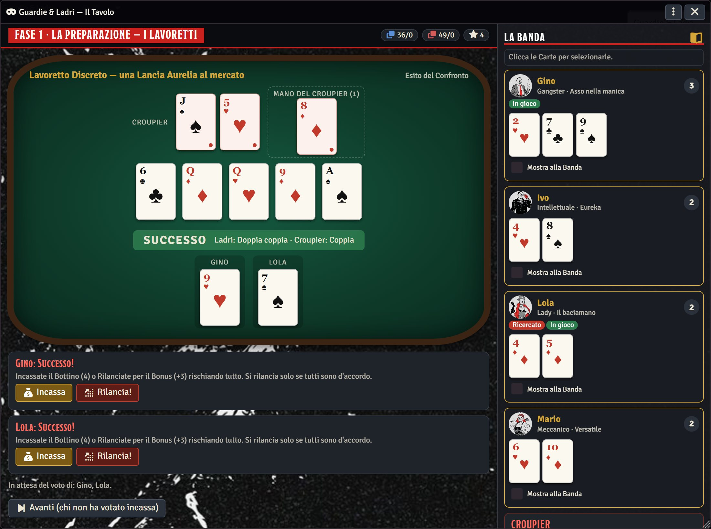
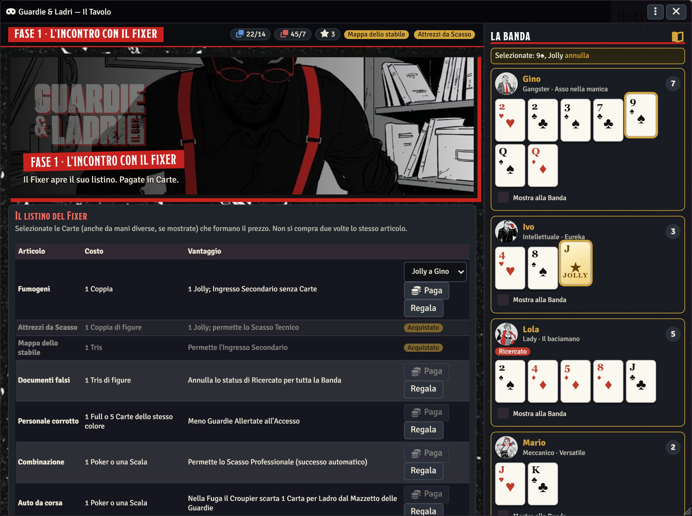
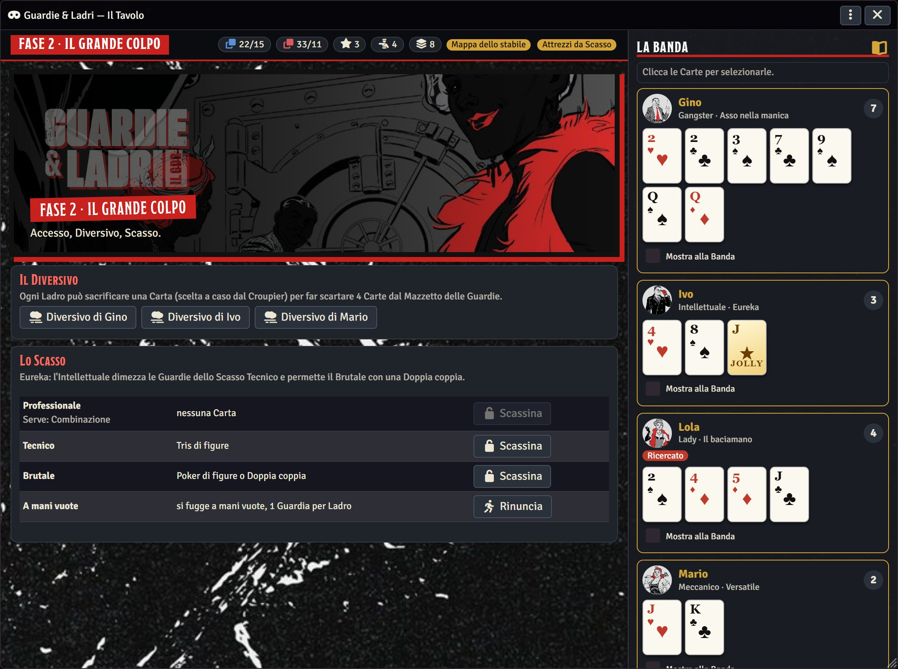
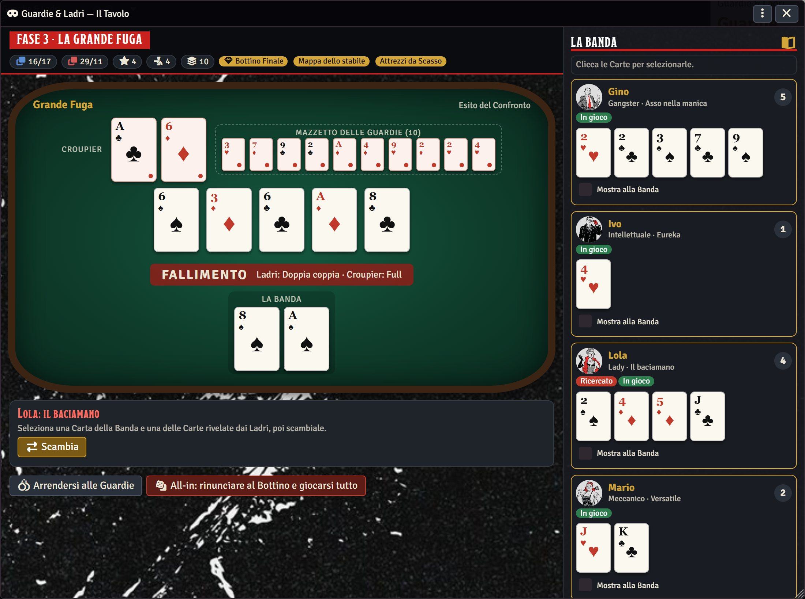
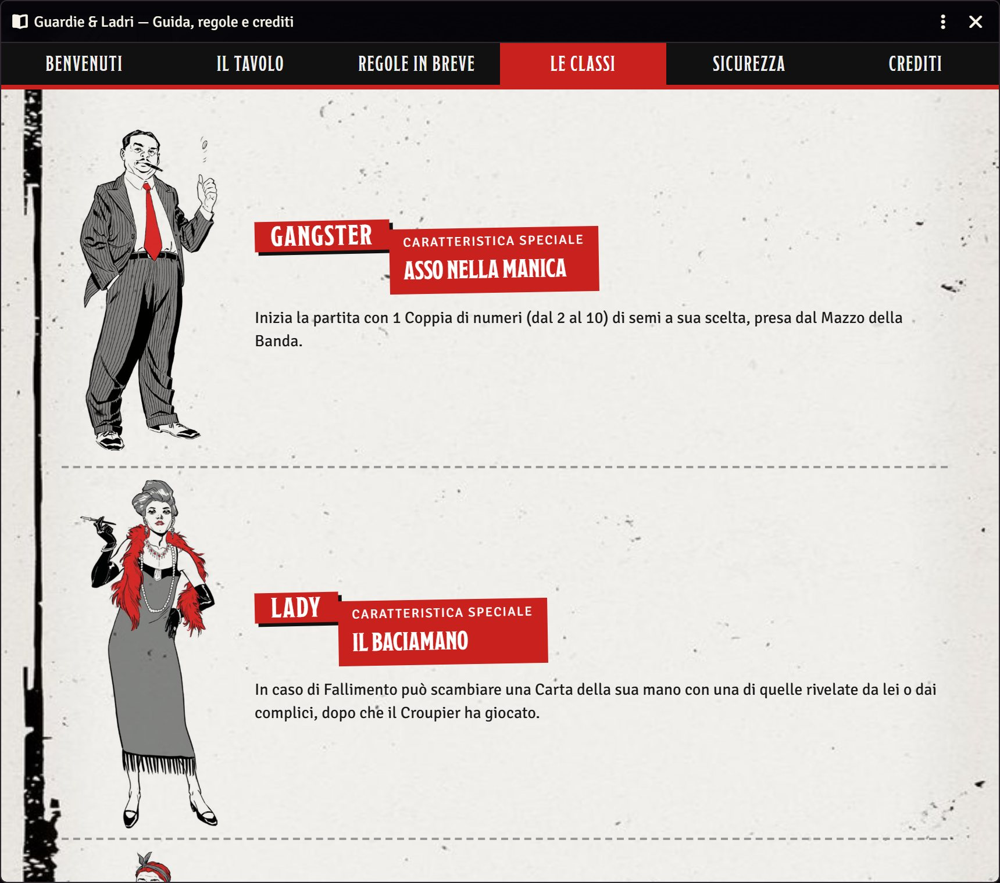

# Guardie & Ladri — sistema per Foundry VTT

Sistema **non ufficiale** per giocare a *Guardie & Ladri* (2025 — un gioco di Atropo Kelevra e Valentino Sergi, regolamento di Alessandro Buniotto ed Elena Mutti, illustrazioni di Luca Erbetta, sviluppato da Officina Meningi) su Foundry Virtual Tabletop v13/v14. Serve il manuale, che è gratuito: [officinameningi.it/guardie-ladri-il-gdr](https://officinameningi.it/guardie-ladri-il-gdr/).

Sviluppato con il consenso degli autori dalla [Taverna di Guido](https://latavernadiguido.it/) · [Instagram](https://www.instagram.com/latavernadiguido) · [TikTok](https://www.tiktok.com/@tavernadiguido) · [YouTube](https://www.youtube.com/@LaTavernadiGuido) · [Twitch](https://www.twitch.tv/latavernadiguido) · [Discord](https://discord.gg/cXbKzYtFmP).

Autori: [Officina Meningi](https://officinameningi.it/) · [Instagram](https://www.instagram.com/officinameningi/) · [Facebook](https://www.facebook.com/officinameningi/) · [YouTube](https://www.youtube.com/@officina_meningi).

- Atropo Kelevra: [scheda su Officina Meningi](https://officinameningi.it/amo-team/atropo-kelevra/)
- Alessandro Buniotto ed Elena Mutti (Boardgames Academy): [Instagram](https://www.instagram.com/boardgames_academy/) · [YouTube](https://www.youtube.com/channel/UCgdeBwcFmW1IgiRMqAXTiGw)
- Luca Erbetta: [Instagram](https://www.instagram.com/lucaerbetta/)



📄 **[Presentazione in PDF](docs/Guardie-e-Ladri-Foundry-Presentazione.pdf)** (15 pagine: il Tavolo, le Fasi, le Classi, requisiti, installazione, link).

## Cosa fa

- **I due Mazzi da Poker** (Banda e Croupier) e i **4 Jolly** custoditi dal Croupier, con mescolate e scarti gestiti dal tavolo.
- **Il Confronto** alla Texas hold'em: flop, turn e river, il ritiro gratuito o con perdita di una Carta, le Carte coperte, il **Rilancio** con Bottino e Bonus, la **Tabella del Grado di Rischio** (Banale, Discreto, Tosto, Esagerato). Valutazione delle mani automatica, Jolly che valgono qualsiasi carta, carte identiche dei due mazzi che non fanno coppia, regola opzionale "Come Quando Fuori Piove".
- **Le quattro Classi** con la loro Caratteristica Speciale: Asso nella manica (Gangster), Il baciamano (Lady), Versatile (Meccanico), Eureka (Intellettuale). Ricercati con la Carta in più.
- **Il Fixer**: listino completo, pagamento con combinazioni verificate (anche con Carte di mani diverse), Jolly di Fumogeni e Attrezzi, Documenti falsi, sconti del Croupier.
- **Il Grande Colpo**: Accesso (Secondario, Incognito, Teatrale), Guardie Allertate e Mazzetto delle Guardie, Diversivo, Scasso (Professionale, Tecnico, Brutale o a mani vuote).
- **La Grande Fuga**: Auto da corsa, Pentiti, Confronto con la mano unica della Banda, **All-in** opzionale.
- **Epilogo** con il riepilogo dei rischi corsi, per il confronto finale con gli *Appunti sulla Ludopatia* del manuale.
- Schede dei Ladri con le 3 domande di Background; messaggi in chat con le carte; "Annulla ultima mossa" per il Croupier.
- **La grafica del manuale**: sfondo d'ingresso e scena del mondo, un'illustrazione per ogni Fase, i ritratti delle Classi, e una **Guida** (regole in breve, Classi, sicurezza, crediti) nello stile del libro. Le illustrazioni si rigenerano dal PDF con `tools/extract-art.py`.

## Come si gioca

1. Il Croupier (GM) crea il mondo con il sistema *Guardie & Ladri*. Ogni giocatore crea il suo Ladro dal Tavolo (lo crea il GM per lui) e compila la scheda.
2. Il Croupier apre il **Tavolo** (icona maschera nei controlli, pulsante in chat o `Alt+T`), sceglie da 2 a 4 Ladri e apre la partita.
3. Tutto si fa dal Tavolo: si cliccano le Carte per selezionarle, poi il pulsante della mossa. Ognuno vede la propria mano; ogni Ladro può mostrarla alla Banda; nella Grande Fuga la Banda gioca come un'unica mano.

Serve un GM connesso: le mosse dei giocatori passano al suo client, che controlla le regole e salva lo stato.

> Le Carte nascoste (mani degli altri, mano del Croupier) non vengono mostrate dall'interfaccia, ma lo stato della partita è condiviso tra i client: chi sa usare la console del browser potrebbe sbirciare. È un gioco tra amici.

## Anteprima

| Il Fixer | Il Grande Colpo |
|---|---|
|  |  |
| **La Grande Fuga** | **La Guida** |
|  |  |

## Installazione

In Foundry: *Sistemi di gioco → Installa sistema* e incolla nel campo *URL del manifesto*:

```
https://github.com/guido92/guardie-e-ladri-foundry/releases/latest/download/system.json
```

### Requisiti

- Foundry VTT 13 o 14 (basta la licenza del Croupier, che ospita la partita: Foundry desktop o un hosting come The Forge).
- I giocatori entrano da browser, schermo di almeno 1366×768.
- Il manuale, gratuito su [officinameningi.it](https://officinameningi.it/guardie-ladri-il-gdr/).

### Provarlo

1. *Mondi → Crea mondo*, sistema **Guardie & Ladri**, avvia il mondo ed entra come Gamemaster.
2. In *Configura giocatori* crea un utente per ogni amico e condividi l'indirizzo del tuo Foundry (tasto *Invita*).
3. Ogni giocatore crea il suo Ladro dal Tavolo; il Croupier spunta i Ladri e preme **Apri il tavolo**.
4. Per una prova da soli: crea 2-4 Ladri senza giocatori, il Croupier li comanda tutti.

In sviluppo: collega la cartella del repo in `Data/systems/guardie-e-ladri` (junction su Windows) e riavvia Foundry.

## Sviluppo

```
npm test                         # 254 test delle regole (node --test), 228 scritti dal manuale da un tester indipendente
node tests/e2e/foundry-e2e.mjs   # partita completa con GM + 3 giocatori collegati (Playwright, Foundry acceso su localhost:30000)
node tools/build.mjs --repo owner/repo   # zip + manifesto in dist/
```

Struttura: `module/core` (carte e tabelle, funzioni pure), `module/game/engine.mjs` (macchina a stati pura), `module/game/gl-game.mjs` (stato, socket, permessi), `module/apps/tavolo.mjs` (il Tavolo). Contratto del motore in [docs/API.md](docs/API.md).

## Licenza

Codice MIT. Il gioco *Guardie & Ladri*, i suoi testi, tabelle e illustrazioni (Luca Erbetta, graphic design di Carolina Fiandri) appartengono agli autori (Atropo Kelevra, Valentino Sergi, Alessandro Buniotto, Elena Mutti) e a Officina Meningi, e sono usati nel sistema con il loro consenso.

*Sistema creato con il supporto dell'intelligenza artificiale.*
